<picture>
  <source media="(max-width: 600px) and (prefers-color-scheme: dark)" srcset="assets/hero-mobile-dark.svg">
  <source media="(max-width: 600px) and (prefers-color-scheme: light)" srcset="assets/hero-mobile-light.svg">
  <source media="(prefers-color-scheme: dark)" srcset="assets/hero-dark.svg">
  <source media="(prefers-color-scheme: light)" srcset="assets/hero-light.svg">
  
</picture>

  <a href="mailto:shyam03072006@gmail.com">Email</a> &nbsp; / &nbsp;
  <a href="https://www.linkedin.com/in/shyam-prasath-s/">LinkedIn</a> &nbsp; / &nbsp;
  <a href="https://sapsynk.tech">Sapsynk</a> &nbsp; / &nbsp;
  <a href="https://github.com/ishyamprasath?tab=repositories">Repositories</a>

### A little about me

I'm **Shyam**, a Computer Science & Engineering student specializing in **AI & Machine Learning** at Sri Krishna College of Technology, based in **Coimbatore, India**. I completed the **Micro Credit Program in Computer Science at IIT Guwahati**.

I build LLM agents, RAG pipelines, computer vision systems, and the full-stack applications around them. My work spans enterprise AI at **TVS Digital**, mobile apps shipped to Google Play and the Apple App Store at **Dendo**, and robotics training with **Techobytes Technologies × eDC IIT Delhi** at IIT Madras Research Park.

### Selected builds

<picture>
  <source media="(prefers-color-scheme: dark)" srcset="assets/projects-dark.svg">
  <source media="(prefers-color-scheme: light)" srcset="assets/projects-light.svg">
  
</picture>

**Live project:** [THOR — Tourism Helper and Organizer with Risk Guard](https://thor-guard-of-tourism.vercel.app) · **AI agents & automation:** [Sapsynk](https://sapsynk.tech)

**Explore the code:** [CXR](https://github.com/ishyamprasath/cxr) · [Personal Budget Tracker](https://github.com/ishyamprasath/personal_budget_tracker) · [Book Similarity Checker](https://github.com/ishyamprasath/book_similarity_checker) · [Carnatic Calm](https://github.com/ishyamprasath/carnatic-calm) · [CyberMind Aviator](https://github.com/ishyamprasath/cybermind_aviator)

Other builds include a **YOLOv11 bird detector** with ONNX edge inference, a **multi-agent Study Optimizer**, **PillPal** for medication assistance, and **Project Vizhi** for ML-based TOR usage detection.

### My toolkit

<picture>
  <source media="(prefers-color-scheme: dark)" srcset="assets/toolkit-dark.svg">
  <source media="(prefers-color-scheme: light)" srcset="assets/toolkit-light.svg">
  
</picture>

Full toolkit in text

| Area | Technologies |
| :--- | :--- |
| Agents & generative AI | Google ADK · LangChain · LangGraph · CrewAI · n8n · RAG |
| Machine learning & vision | TensorFlow · AutoGluon · scikit-learn · OpenCV · YOLO · ONNX · Hugging Face |
| Application development | Python · Java · FastAPI · React · React Native · Next.js · Spring Boot |
| Cloud & infrastructure | Azure · GCP · AWS · Docker · Kubernetes · CI/CD |
| Data & robotics | PostgreSQL · MongoDB · Pinecone · ChromaDB · ROS 2 · Jetson Nano |

### Experience & milestones

- **Dendo** — App Development Intern · June–August 2026. Cross-platform React Native apps with an AWS backend, shipped to Google Play and the Apple App Store.
- **Techobytes Technologies × eDC IIT Delhi** — Generative AI Intern · June 1–July 30, 2026, remote. Theory, practical work, and an object-detection web application course project.
- **Techobytes Technologies × eDC IIT Delhi** — IoT & Robotics (ROS) Summer Intern · June 15–20, 2026, at IIT Madras Research Park, Chennai. Six days and 40 hours of hands-on ROS 2, vision, and robotics training.
- **TVS Digital** — SDE Intern, AI & Full-Stack Engineering · May–June 2026. Multi-agent systems, RAG, and AI/XR platforms.
- **ApexPlanet Software** — App Development Intern · August–October 2025.
- **Microsoft–AICTE** — AI Azure Intern · June–July 2025.
- **Vital Skills with Techkriti, IIT Kanpur** — Machine Learning Intern · January–February 2025. Creditworthiness prediction.

### Recognition & learning

- **Azure AI Codeathon 2025** — First prize, with $1,000 in Azure credits.
- **CSC Summer Impactathon 2026** — CSC Impact Honorable Mention for XRPLOT-AI · August 2026.
- **Engineers' Day Project Competition 2026** — Winner, DR.ENGINE, Sri Krishna College of Engineering and Technology.
- **DevHack 7.0 CodeCraft Sprint** — Second rank; **Singularity AI Hackathon, IIT Dharwad** — Top 16 finalist · January 2026.
- **AI IGNITE 2025** — Consolation prize for FabPal, ₹10,000 · February 2026.

**70+ completed certifications**, including Gemini Certified Student, Google AI Essentials, Kaggle's AI Agents Intensive with Google, Anthropic's Claude Code 101 and AI Fluency, and NVIDIA's Getting Started with AI on Jetson Nano.

### Contribution playground

<picture>
  <source media="(prefers-color-scheme: dark)" srcset="assets/activity-dark.svg">
  <source media="(prefers-color-scheme: light)" srcset="assets/activity-light.svg">
  
</picture>

Curious about agents, useful AI, and what happens when software meets the physical world.

<!-- Maintainer instructions: see docs/PROFILE.md. -->
